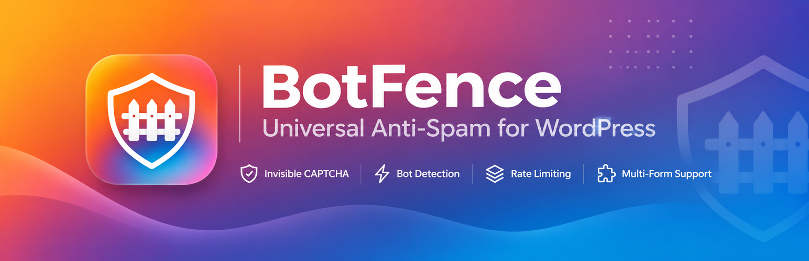

<div align="center">

</div>

# BotFence — Official Web Portal & Download Hub

Live Website: **[https://bot-fence.vercel.app/](https://bot-fence.vercel.app/)**

Minimalist neo-brutalist landing page and direct package distribution portal for **BotFence**, the zero-CAPTCHA WordPress security plugin that protects every form.

## Deployment on Vercel

- **Root Directory:** `frontend`
- **Build Command:** `npm run build`
- **Output Directory:** `dist`

### Environment Variables
Configure these in the Vercel Project Dashboard (Settings > Environment Variables):
- `VITE_TELEGRAM_BOT_TOKEN`: Your Telegram Bot API token from [@BotFather](https://t.me/BotFather)
- `VITE_TELEGRAM_CHAT_ID`: Your Telegram Chat/Channel ID to receive new download notifications

## Run Locally

```bash
cd frontend
npm install
npm run dev
```
